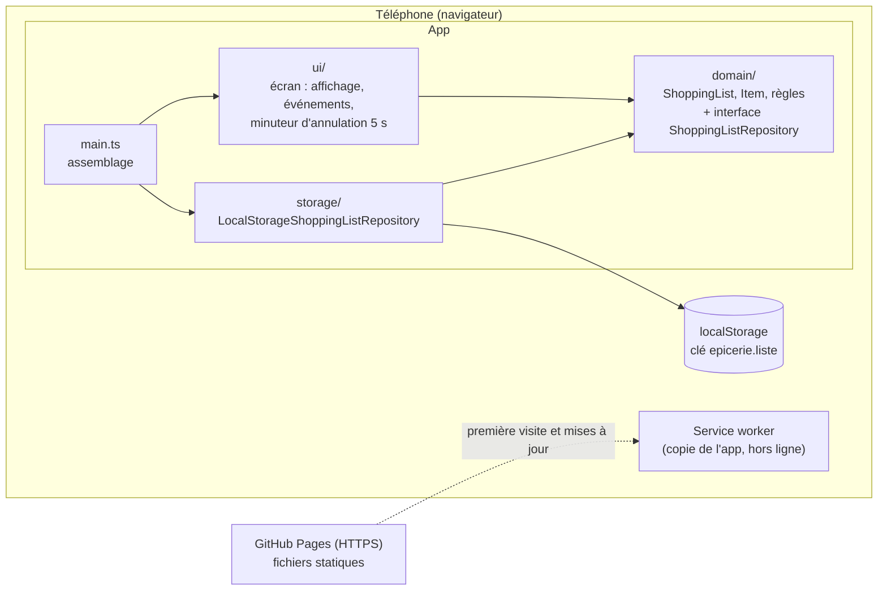

# Architecture — Ma liste d'épicerie

Statut : s'appuie sur les ADR 0001 à 0007, toutes « Acceptée » le 2026-10-19 (voir `docs/decisions/`).
Plateforme cible principale : **l'iPhone de Math, Safari iOS, app installée sur l'écran d'accueil** (voir « Plateforme cible » plus bas).

## Vue d'ensemble
Une **PWA** : un site statique installé sur l'écran d'accueil du téléphone. Aucun serveur applicatif. La liste vit dans le **localStorage** du téléphone ; un **service worker** garde une copie de l'app pour qu'elle s'ouvre sans réseau.

Clean Architecture **allégée**, proportionnée à une app d'un écran :
- un **domaine** pur (règles métier, aucune dépendance au navigateur) ;
- deux **adaptateurs** : le stockage et l'écran ;
- un **point d'assemblage** (`src/main.ts`) qui les relie.
Pas de couche « cas d'usage » séparée tant que chaque action se résume à un appel au domaine suivi d'un enregistrement ; on l'ajoutera si les actions se compliquent.



**Règle de dépendance** : les flèches pointent vers `domain/`. Le domaine n'importe rien de `ui/`, `storage/`, ni des API du navigateur (`window`, `document`, `localStorage`, `setTimeout`).

## Structure des dossiers
```
apps/epicerie/
├── index.html                 page unique de l'app
├── public/icon.svg            icône provisoire (à remplacer : Jean-François)
├── src/
│   ├── main.ts                assemblage : crée le dépôt, charge la liste, monte l'écran, enregistre le service worker
│   └── shopping-list/         le seul domaine fonctionnel : la liste d'épicerie
│       ├── domain/            entités et règles pures + interface ShoppingListRepository
│       ├── storage/           implémentation localStorage du dépôt
│       └── ui/                rendu DOM, événements, messages, bandeau hors ligne
├── e2e/                       tests de bout en bout Playwright (un fichier par story)
└── docs/                      produit, UX, décisions, ce document
```
Noms de code en anglais (comme le reste de l'équipe) ; textes d'interface en français, repris de `docs/ux/`.

Glossaire code ↔ produit : `ShoppingList` = la liste ; `Item` = un article ; `checked` = coché (« Dans le panier ») ; `unchecked` = « À prendre ».

## Frontières
| Frontière | Défini dans | Implémenté dans | Testé avec |
|---|---|---|---|
| `ShoppingListRepository` : `load()` → liste ; `save(liste)` ; erreurs explicites (stockage plein, données illisibles) | `domain/` | `storage/` (localStorage) | une implémentation en mémoire pour les tests du domaine et de l'écran ; localStorage de happy-dom pour les tests du dépôt |
| Horloge (minuteur d'annulation de 5 s) | reste dans `ui/` (c'est un comportement d'écran) | `setTimeout` | faux minuteurs de Vitest (`vi.useFakeTimers()`) |
| Identifiants d'articles | `domain/` reçoit une fonction qui génère un identifiant | `crypto.randomUUID()` dans `main.ts` | identifiants prévisibles dans les tests |

## Flux principal (ajouter un article, EPI-001)
1. `ui/` lit le champ, appelle le domaine (ex. `list.add(name)`).
2. Le domaine applique les règles (espaces retirés, 1 à 100 caractères, ajout à la fin des non cochés) et renvoie la nouvelle liste ou une erreur de validation.
3. `ui/` demande au dépôt d'**enregistrer immédiatement** la liste (`save`), puis redessine l'écran à partir de la liste.
4. Si `save` échoue, `ui/` affiche le message d'erreur d'enregistrement (écran 9, si Jean-Marc le retient).

Même schéma pour cocher, supprimer et annuler. À l'ouverture : `main.ts` appelle `load()` puis affiche.

## Conventions
- Le domaine est **immuable** de préférence (chaque action renvoie une nouvelle liste) : l'annulation de suppression revient à réinsérer l'article à son index d'origine, sans magie.
- Format stocké : `{ "version": 1, "items": [{ "id", "name", "checked" }] }` dans l'ordre d'affichage. Toute évolution de format incrémente `version` avec une migration testée.
- Écran : une fonction de rendu qui redessine la liste à partir de l'état ; pas de modifications du DOM éparpillées. Respecter les exigences d'accessibilité des wireframes (focus, `role="status"`).
- Ne pas importer `virtual:pwa-register` ailleurs que dans `main.ts`.

---

## Réponses aux réserves du backlog (2026-10-19)
Légende : **[vérifié]** = documentation ou source consultée ; **[constaté]** = comportement largement rapporté par les développeurs, sans documentation officielle d'Apple ; **[non vérifié]** = à confirmer par un essai sur l'iPhone de Math.

### EPI-001 — « Clavier ouvert à l'ouverture de l'app »
**Non réalisable de façon fiable sur iPhone [constaté].** Safari iOS n'ouvre le clavier que si l'utilisateur vient de toucher l'écran. Quand le code place le curseur dans un champ tout seul (`focus()` au chargement, attribut `autofocus`), le clavier ne s'ouvre pas. Apple ne propose aucun réglage pour contourner ce blocage dans une app web, même installée. Sur Android (Chrome), c'est en général possible.

Alternative la plus proche, que je recommande :
1. À l'ouverture, le code **donne quand même le focus au champ** « Nouvel article ». Ça ne coûte rien, ça marche sur Android et avec un clavier physique, et sur iPhone le champ est prêt pour le premier toucher.
2. **Un seul toucher** sur le champ ouvre le clavier. Pour que ce toucher soit facile au pouce, le champ est **grand et en bas de l'écran**, comme dans les wireframes. Jean-François peut aussi élargir la zone : toucher n'importe où dans la barre d'ajout donne le focus au champ.
3. Une fois le clavier ouvert, il **reste ouvert** entre deux ajouts : après un ajout, le focus reste dans le champ, ce qui est déjà prévu par EPI-001.

Effet sur les critères : le scénario « prêt à écrire dès l'ouverture » devient, sur iPhone, « le champ est en bas, visible, et un toucher ouvre le clavier ». L'objectif « ajouté en moins de 5 s » reste tenable avec ce toucher de plus.
**[non vérifié]** Si l'app était encore en veille avec le clavier ouvert, iOS peut rouvrir le clavier au retour. C'est un bonus possible, pas un engagement.

### EPI-015 — Thème sombre
**Confirmé : le thème repose sur des variables de couleur CSS.** Une **variable CSS** est une couleur nommée (ex. `--couleur-fond`) définie une seule fois et utilisée partout.
- Les couleurs du design system sont déclarées comme variables sur `:root`, avec les valeurs claires. Un bloc `@media (prefers-color-scheme: dark)` redéfinit les mêmes variables avec les valeurs sombres. Aucun composant n'écrit une couleur en dur. `prefers-color-scheme` est le réglage d'apparence du téléphone, lu par le navigateur.
- Le passage clair ↔ sombre pendant l'usage est **instantané** et ne touche ni la saisie ni la liste, puisque seul le CSS change, sans recharger la page **[vérifié : comportement standard de `prefers-color-scheme`]**.
- Pour éviter l'**éclair blanc** au chargement :
  - `<meta name="color-scheme" content="light dark">` dans `index.html` et `color-scheme: light dark` sur `:root`. Le navigateur peint ainsi son fond par défaut en sombre avant même que notre CSS soit lu.
  - Les variables et la couleur de fond de `body` sont mises **dans `<head>`**, en CSS chargé avant le contenu (Vite place le CSS de production dans `<head>`). Le fond n'est jamais choisi par le JavaScript.
  - Deux balises `<meta name="theme-color" media="(prefers-color-scheme: light|dark)">` colorent la barre d'état et la barre du navigateur selon le thème. La balise blanche unique actuelle est à remplacer.
- **[non vérifié]** L'écran de démarrage d'une app installée sur iPhone peut afficher brièvement un fond blanc avant que la page soit peinte, car iOS ne lit pas les couleurs de démarrage du manifeste. Julie le vérifie en suivant le scénario « pas d'éclair blanc » (5 essais). S'il y a un éclair, la parade consiste à ajouter des images de démarrage iOS (`apple-touch-startup-image`), une claire et une sombre. Ce petit travail s'ajouterait à la story.
- Le manifeste n'accepte qu'**une** `background_color` (écran de démarrage sur Android) : on choisit la couleur sombre ou une couleur neutre, à décider avec Jean-François. C'est secondaire puisque la cible est l'iPhone.

### EPI-016 — Pannes de stockage
| Panne | Détectable ? | Comment |
|---|---|---|
| **Stockage plein** (quota du site ou téléphone plein) | **Oui**, immédiatement | `localStorage.setItem` lève une erreur `QuotaExceededError` **[vérifié : spécification et MDN]** ; le dépôt la transforme en erreur « enregistrement impossible ». **[non vérifié]** On ne sait pas comment un iPhone vraiment plein se comporte, mais le cas est couvert par le même `try/catch`. |
| **Accès refusé** (stockage désactivé par un réglage de confidentialité) | **Oui**, au démarrage | La lecture de `window.localStorage` ou la première écriture lève une erreur (`SecurityError` selon le navigateur). Au démarrage, le dépôt fait une **écriture-lecture de contrôle** sur une clé technique : si elle échoue, l'erreur est signalée tout de suite, avant que Math tape un article. |
| **Données illisibles** (texte non JSON, structure invalide, `version` inconnue) | **Oui**, au chargement | Le dépôt valide ce qu'il lit. Si c'est illisible : il **copie le texte brut** sous une clé de secours numérotée (`epicerie.liste.illisible.1`, `.2`… jusqu'à 5, sans doublon, jamais écrasée ni supprimée : voir la précision de l'ADR 0003), **vérifie que la copie est écrite**, signale l'erreur, puis démarre avec une liste vide. Il faut un message pour ce cas : **à décider par Jean-Marc et Jean-François**, il n'est dans aucune story aujourd'hui. |
| **Effacement après coup** (Safari qui efface les données, l'utilisateur qui supprime l'app ou les données du site, téléphone réinitialisé) | **Non** | L'app retrouve une liste vide, comme au premier lancement, et ne peut pas savoir qu'il y avait quelque chose avant. La parade est préventive : app installée et ouverte depuis l'icône (condition acceptée par Math, ADR 0003) et `navigator.storage.persist()`. |
| **Fermeture brutale juste après un enregistrement** | **Non**, côté app | Pour l'app, l'écriture réussit tout de suite. **[non vérifié]** Le navigateur écrit ensuite sur le disque en différé ; si iOS tue l'app dans la fraction de seconde suivante, la dernière modification pourrait manquer. Julie le teste à la main (« fermeture pendant le délai d'annulation », EPI-005 et EPI-006). Si le test échoue, nouvel ADR (IndexedDB, dont on peut attendre la confirmation d'écriture). |

Règles pour le dépôt et l'écran :
- La liste affichée (en mémoire) est la référence. Comme on **enregistre toujours la liste entière**, le prochain enregistrement réussi (« Réessayer » ou n'importe quel changement suivant) rattrape **tous** les changements non enregistrés.
- Pas d'autre stockage de secours : IndexedDB est soumis au même quota et au même effacement, il ne protège de rien ici.

Comment simuler ces pannes dans les tests (« échec simulé ») :
- **Tests unitaires (Vitest)** :
  - Le dépôt reçoit le stockage en paramètre (un objet qui a `getItem` / `setItem`, comme `localStorage`). Les tests lui passent un faux stockage dont `setItem` lève `new DOMException("plein", "QuotaExceededError")`, ou dont l'accès lève `SecurityError`, ou qui contient d'avance `"{pas du json"` ou `{"version":99}`.
  - Pour tester l'écran, une version en mémoire de `ShoppingListRepository` peut être réglée pour échouer, puis réussir (« Réessayer »).
- **Tests de bout en bout (Playwright)** : on ne modifie pas le code de production. Le test injecte un script **avant** le chargement de l'app (`page.addInitScript`) :
  - Échec d'enregistrement : remplacer `Storage.prototype.setItem` par une fonction qui lève `QuotaExceededError` tant qu'un drapeau `window.__echecStockage` est vrai. Le test met ensuite le drapeau à faux pour simuler « problème réglé » puis touche « Réessayer ».
  - Données illisibles : écrire `"{pas du json"` dans `epicerie.liste` avant le premier chargement.
  - Quota réellement plein : remplir le localStorage avec environ 5 Mo de texte sous une autre clé. Ça fonctionne dans Chromium et WebKit, mais c'est plus lent, donc à réserver à un seul test.
  - Ces tests tournent sur les deux projets (android-chrome et iphone-safari).
- **Sur l'iPhone réel** : remplir vraiment le téléphone n'est pas raisonnable. On se fie aux tests simulés et on ne fait pas de test manuel de panne.

### EPI-004 — Premier lancement sans réseau, et moment des mises à jour
**Tout premier lancement sans réseau : impossible, et aucun message en français n'est possible non plus.** Tant que l'app n'a jamais été téléchargée sur le téléphone, aucun de nos fichiers n'y est. Il n'y a donc aucun code à nous pour afficher un message. C'est Safari qui affiche sa propre page d'erreur (« Safari ne peut pas ouvrir la page »). Aucune des deux variantes du scénario [DÉPEND ADR] n'est réalisable telle quelle.
Sur iPhone, il y a en plus un piège : l'app installée a **son propre stockage, séparé de Safari** **[vérifié : sources tierces concordantes ; détail non documenté par Apple]**. **[non vérifié]** Il n'est pas certain que la copie hors ligne faite pendant la visite dans Safari serve à l'app installée. D'où la règle d'installation, simple et sûre :
> Ajouter l'app à l'écran d'accueil depuis Safari, puis **l'ouvrir une fois depuis son icône avec du réseau**. Ensuite, elle fonctionne en mode avion.

Proposition pour Jean-Marc : remplacer le scénario par une **règle d'installation documentée** (README et aide d'installation), et tester la condition inverse : « Étant donné que j'ai ouvert l'app une fois depuis son icône avec du réseau, quand je l'ouvre en mode avion, alors ma liste s'affiche ». En option (Could, non nécessaire), l'app pourrait afficher une fois « Prête à fonctionner sans réseau » quand la copie hors ligne est terminée.

**Moment où une nouvelle version s'applique** : voir l'**ADR 0007**. En résumé :
- la nouvelle version se télécharge seule, quand l'app est ouverte avec du réseau ;
- elle s'applique à la **prochaine ouverture après une fermeture complète** (sur iPhone : app balayée dans le sélecteur d'apps, fermée par iOS ou téléphone redémarré) ;
- jamais de rechargement en plein usage ; la liste n'est jamais touchée par une mise à jour (stockage séparé) ;
- sans réseau, aucune vérification visible et aucune erreur.

Règle testable proposée pour le scénario « quand la nouvelle version s'applique » : « Étant donné qu'une nouvelle version a été publiée et que j'ai ouvert l'app avec du réseau, quand je continue à l'utiliser, alors la version ne change pas et l'écran ne se recharge pas ; quand je ferme complètement l'app puis la rouvre, alors la nouvelle version est utilisée et ma liste est intacte. »

**Découpage : oui, je le recommande.** Le hors ligne est une affaire de réglage et de tests simples. Les mises à jour demandent un changement de réglage (ADR 0007) et surtout un test de bout en bout lourd : construire deux versions, servir la première, puis la seconde. Ce sont deux risques différents. Proposition :
- **EPI-004 — Utiliser ma liste sans connexion** : consulter et tout faire hors ligne, ouverture hors ligne après usage normal, bandeau, retour du réseau, règle d'installation, mise à jour sans réseau sans erreur.
- **EPI-004b — Mises à jour sans risque** : « mise à jour sans risque pour ma liste », « jamais interrompu », « quand la nouvelle version s'applique ». **Doit être faite avant le premier déploiement public** (le réglage est pénible à changer après).

## Plateforme cible : iPhone (pour Julie et pour les tests)
- **Installation** : ouvrir l'adresse dans **Safari**, bouton Partager → « Sur l'écran d'accueil ». **[vérifié : MacRumors, iOS 26]** Depuis iOS 26, la fenêtre d'ajout a une option « Ouvrir en tant qu'app web », activée par défaut : elle doit **rester activée**, sinon on obtient un simple signet qui s'ouvre dans Safari, et la liste n'est plus protégée. Contrôle : ouverte depuis l'icône, l'app s'affiche **sans barre d'adresse Safari**.
- **Deux stockages distincts** : une liste tapée dans un onglet Safari n'apparaît pas dans l'app installée, et inversement. Ce n'est pas un bogue. Les tests de persistance se font **dans l'app installée**.
- **Repartir de zéro** (premier lancement) : supprimer l'icône de l'écran d'accueil, puis réinstaller. **[non vérifié]** Cette suppression efface normalement les données de l'app ; Julie le confirme une fois.
- **« Fermer » ou « rouvrir » l'app** (EPI-003, EPI-004, EPI-005, ADR 0007) : balayer l'app vers le haut dans le sélecteur d'apps, puis la relancer depuis l'icône. Revenir à l'écran d'accueil puis retoucher l'icône **ne ferme pas** l'app : iOS la réveille, ce n'est pas une vraie ouverture.
- **Mode avion réel** : activer le mode avion **et vérifier que le Wi-Fi et le Bluetooth sont coupés**, car iOS laisse le Wi-Fi allumé en mode avion si on l'a réactivé une fois. Ensuite, fermer complètement l'app puis la rouvrir. Tester aussi après un **redémarrage** du téléphone en mode avion.
- **Bandeau « Hors ligne »** : il se fonde sur l'indicateur réseau du navigateur. Branché à un Wi-Fi sans Internet (portail d'hôtel, réseau saturé), le téléphone peut se croire en ligne et ne pas afficher le bandeau **[vérifié : MDN, `navigator.onLine`]**. Ce n'est pas un défaut, puisque l'app fonctionne de toute façon sans réseau. Le bandeau est une information, pas une garantie.
- **Clavier** : sur iPhone, il ne s'ouvre pas tout seul à l'ouverture (voir EPI-001 ci-dessus). Ce n'est pas un bogue, une fois la story ajustée.
- **Thème sombre** : Réglages → Luminosité et affichage, ou le Centre de contrôle, app ouverte. Pour l'éclair blanc : 5 ouvertures à froid (app fermée complètement) en mode sombre.
- **Inspection** : l'Inspecteur web de Safari sur Mac (iPhone branché par câble, réglage « Inspecteur web » activé dans Réglages → Apps → Safari → Avancé) permet de voir le localStorage et le service worker de l'app installée. Utile pour vérifier une version ou un contenu stocké.
- **Limites de l'automatisation** : le projet Playwright « iphone-safari » utilise le moteur WebKit sur ordinateur, pas Safari sur iPhone. Il couvre l'affichage, les parcours et les pannes simulées. L'installation, le mode avion, les mises à jour et l'éclair blanc se vérifient **à la main sur l'iPhone de Math**.
- **Effacement après 7 jours** (ADR 0003) : non testable dans un délai raisonnable ; l'app installée en est exemptée **[vérifié : WebKit]**.
