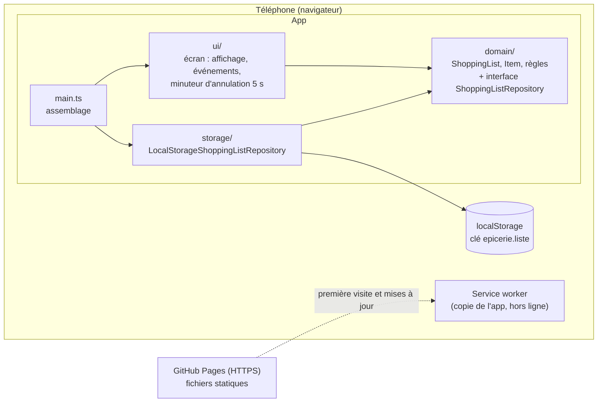

# Architecture — Ma liste d'épicerie

Statut : s'appuie sur les ADR 0001 à 0006 (voir `docs/decisions/`). Tant que 0001 à 0005 sont « Proposée », ce document est une proposition.

## Vue d'ensemble
Une **PWA** : un site statique installé sur l'écran d'accueil du téléphone. Aucun serveur applicatif. La liste vit dans le **localStorage** du téléphone ; un **service worker** garde une copie de l'app pour qu'elle s'ouvre sans réseau.

Clean Architecture **allégée**, proportionnée à une app d'un écran :
- un **domaine** pur (règles métier, aucune dépendance au navigateur) ;
- deux **adaptateurs** : le stockage et l'écran ;
- un **point d'assemblage** (`src/main.ts`) qui les relie.
Pas de couche « cas d'usage » séparée tant que chaque action se résume à un appel au domaine suivi d'un enregistrement ; on l'ajoutera si les actions se compliquent.



**Règle de dépendance** : les flèches pointent vers `domain/`. Le domaine n'importe rien de `ui/`, `storage/`, ni des API du navigateur (`window`, `document`, `localStorage`, `setTimeout`).

## Structure des dossiers
```
apps/epicerie/
├── index.html                 page unique de l'app
├── public/icon.svg            icône provisoire (à remplacer : Jean-François)
├── src/
│   ├── main.ts                assemblage : crée le dépôt, charge la liste, monte l'écran, enregistre le service worker
│   └── shopping-list/         le seul domaine fonctionnel : la liste d'épicerie
│       ├── domain/            entités et règles pures + interface ShoppingListRepository
│       ├── storage/           implémentation localStorage du dépôt
│       └── ui/                rendu DOM, événements, messages, bandeau hors ligne
├── e2e/                       tests de bout en bout Playwright (un fichier par story)
└── docs/                      produit, UX, décisions, ce document
```
Noms de code en anglais (comme le reste de l'équipe) ; textes d'interface en français, repris de `docs/ux/`.

Glossaire code ↔ produit : `ShoppingList` = la liste ; `Item` = un article ; `checked` = coché (« Dans le panier ») ; `unchecked` = « À prendre ».

## Frontières
| Frontière | Défini dans | Implémenté dans | Testé avec |
|---|---|---|---|
| `ShoppingListRepository` : `load()` → liste ; `save(liste)` ; erreurs explicites (stockage plein, données illisibles) | `domain/` | `storage/` (localStorage) | une implémentation en mémoire pour les tests du domaine et de l'écran ; localStorage de happy-dom pour les tests du dépôt |
| Horloge (minuteur d'annulation de 5 s) | reste dans `ui/` (c'est un comportement d'écran) | `setTimeout` | faux minuteurs de Vitest (`vi.useFakeTimers()`) |
| Identifiants d'articles | `domain/` reçoit une fonction qui génère un identifiant | `crypto.randomUUID()` dans `main.ts` | identifiants prévisibles dans les tests |

## Flux principal (ajouter un article, EPI-001)
1. `ui/` lit le champ, appelle le domaine (ex. `list.add(name)`).
2. Le domaine applique les règles (espaces retirés, 1 à 100 caractères, ajout à la fin des non cochés) et renvoie la nouvelle liste ou une erreur de validation.
3. `ui/` demande au dépôt d'**enregistrer immédiatement** la liste (`save`), puis redessine l'écran à partir de la liste.
4. Si `save` échoue, `ui/` affiche le message d'erreur d'enregistrement (écran 9, si Jean-Marc le retient).

Même schéma pour cocher, supprimer et annuler. À l'ouverture : `main.ts` appelle `load()` puis affiche.

## Conventions
- Le domaine est **immuable** de préférence (chaque action renvoie une nouvelle liste) : l'annulation de suppression revient à réinsérer l'article à son index d'origine, sans magie.
- Format stocké : `{ "version": 1, "items": [{ "id", "name", "checked" }] }` dans l'ordre d'affichage. Toute évolution de format incrémente `version` avec une migration testée.
- Écran : une fonction de rendu qui redessine la liste à partir de l'état ; pas de modifications du DOM éparpillées. Respecter les exigences d'accessibilité des wireframes (focus, `role="status"`).
- Ne pas importer `virtual:pwa-register` ailleurs que dans `main.ts`.
