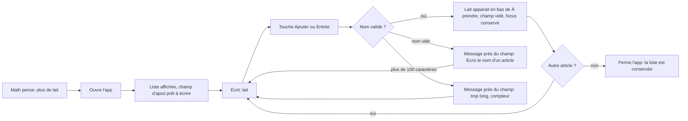
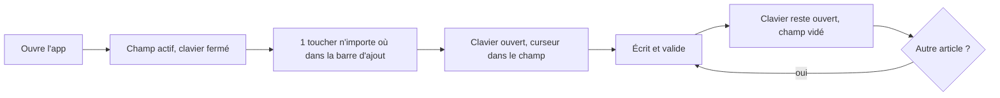
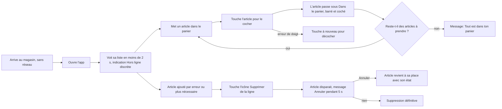
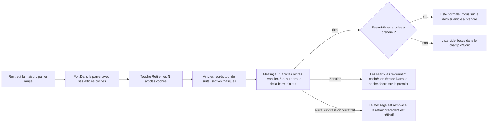
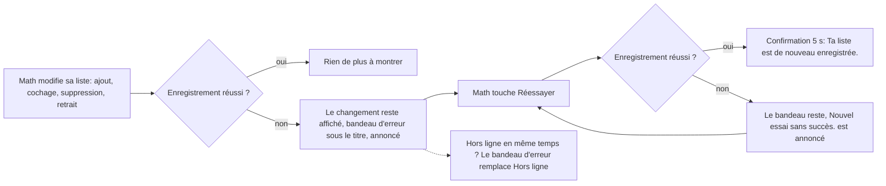
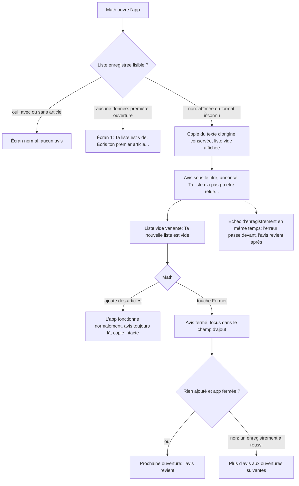

# Parcours — Ma liste d'épicerie (MVP)

Statut : **Proposé** — Jean-François (UX), 2026-10-19. Périmètre : EPI-001 à EPI-006 et EPI-016 (validé par Math). Mise à jour 2026-10-19 : parcours 3 (EPI-006) et 4 (EPI-016) ajoutés.

## Utilisateur et contexte

**Proto-persona : Math** *(hypothèse : jamais observé en situation réelle ; à confirmer après 3 semaines d'usage)*
- Seul utilisateur, francophone québécois, tutoiement dans l'interface.
- Appareil : téléphone, écran d'environ 360 px de large, **une main**, le pouce fait tout le travail.
- Deux situations :
  1. **À la maison** : en pleine action (cuisine, mains parfois mouillées), il pense « plus de lait » et veut noter ça en moins de 5 secondes, puis retourner à ce qu'il faisait.
  2. **Au magasin** : debout, une main sur le panier, éclairage fort, réseau souvent absent. Il veut voir d'un coup d'œil « ce qu'il me reste à prendre ».
- Frustrations : papier égaré, notes éparpillées, article oublié, application lente à ouvrir.

Principes qui en découlent :
- **Le champ d'ajout est déjà actif à l'ouverture** et placé **en bas** (zone du pouce).
- **Une seule action principale par écran** : ajouter. Cocher est l'action répétée, donc la plus grande cible.
- **Rien n'est jamais bloquant** : pas de confirmation avant suppression, mais une annulation possible (contrôle et liberté).

## Parcours 1 — Noter un article à la maison (EPI-001, EPI-003)

Sur iPhone, l'étape « champ prêt » comporte **un toucher** (le clavier ne peut pas s'ouvrir seul) :

Raison de chaque étape :
- *Champ prêt à l'ouverture* : l'objectif « moins de 5 s » ne laisse pas de place à un bouton « + » qui ouvre un autre écran. Sur iPhone, un seul toucher dans une barre entièrement touchable (≥ 48 px, pleine largeur) remplace l'ouverture automatique du clavier, impossible sur cette plateforme.
- *Focus conservé après l'ajout* : on note souvent plusieurs articles d'affilée (clavier reste ouvert).
- *Erreur près du champ* : l'utilisateur corrige sans chercher ; le texte saisi n'est jamais effacé.

## Parcours 2 — Faire l'épicerie au magasin (EPI-002, EPI-004, EPI-005)

Raison de chaque étape :
- *Aucun écran de chargement ni de connexion* : tout est local, la liste s'affiche d'abord.
- *Indication hors ligne discrète* : informative et rassurante, pas une alerte (rien ne cesse de fonctionner).
- *Cocher = toucher la ligne entière* (grande cible, loi de Fitts) ; décocher est le même geste (cohérence, réversibilité).
- *Supprimer = bouton visible sur chaque ligne*, pas de glissement : un glissement n'est pas découvrable, pas faisable au clavier ni avec un lecteur d'écran (WCAG 2.5.7).
- *Pas de confirmation avant suppression* mais annulation : plus rapide qu'un « Es-tu sûr ? » qu'on valide par réflexe (prévenir/corriger les erreurs).

## Parcours 3 — Repartir à zéro après l'épicerie (EPI-006)

Raison de chaque étape :
- *Bouton en fin de section, avec le nombre dans le libellé* : on sait ce qui part avant de toucher ; pas de confirmation parce que l'annulation de 5 s la remplace (décision de Math, même mécanique que EPI-005 : cohérence).
- *Retrait immédiat* : une confirmation qu'on valide par réflexe protège moins qu'une annulation, et ralentit le geste de fin d'épicerie.
- *Un seul message à la fois* : l'écran reste lisible ; en échange, une nouvelle suppression ou un nouveau retrait rend le précédent définitif (règle décidée par Math, communiquée dans le message lui-même par son remplacement).
- *Après « tout retiré »* : liste vide (écran 1), prête pour la semaine suivante.

## Parcours 4 — Quand l'enregistrement échoue (EPI-016)

Raison de chaque étape :
- *Le changement reste affiché* : rien ne disparaît, Math peut recopier ou réessayer plutôt que de tout retaper.
- *Bandeau sous le titre, persistant* : visible dès qu'il regarde l'écran, jamais chassé par un message temporaire.
- *Erreur prioritaire sur « Hors ligne »* : « Ta liste fonctionne normalement » ne doit jamais s'afficher en même temps que « Impossible d'enregistrer » (heuristique 1 : état du système fidèle).

## Parcours 5 — Quand la liste enregistrée est illisible (EPI-017)

Raison de chaque étape :
- *Un avis, pas une liste vide muette* : sans lui, Math croirait à un premier lancement, ajouterait des articles et ignorerait que son ancienne liste existe (heuristique 1, état du système ; « zéro article perdu »).
- *« Rien n'est effacé »* : la première question de Math est « ai-je tout perdu ? » ; la réponse vient avant toute explication.
- *Pas de bouton de récupération* : décision de Math, la copie reste sur le téléphone. Le texte ne promet donc que ce qui est vrai : « une copie est gardée ».
- *Reste jusqu'à « Fermer »* : l'information ne se répète pas et un délai la ferait manquer ; la fermeture est volontaire (contrôle et liberté) et ne dure que la session, car le problème, lui, tant que rien n'est enregistré, existe toujours.
- *« Ta nouvelle liste est vide »* : la liste vide n'est jamais présentée comme une première ouverture.
