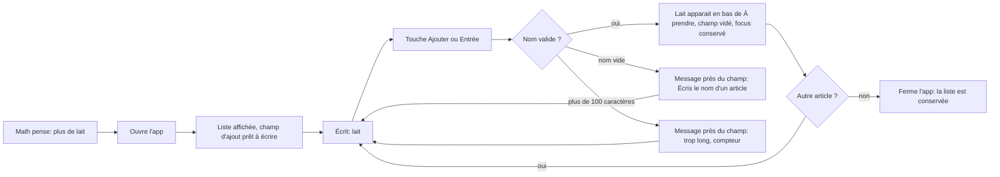
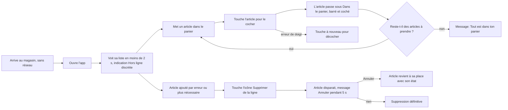

# Parcours — Ma liste d'épicerie (MVP)

Statut : **Proposé** — Jean-François (UX), 2026-10-19. Périmètre : EPI-001 à EPI-005 (validé par Math).

## Utilisateur et contexte

**Proto-persona : Math** *(hypothèse : jamais observé en situation réelle ; à confirmer après 3 semaines d'usage)*
- Seul utilisateur, francophone québécois, tutoiement dans l'interface.
- Appareil : téléphone, écran d'environ 360 px de large, **une main**, le pouce fait tout le travail.
- Deux situations :
  1. **À la maison** : en pleine action (cuisine, mains parfois mouillées), il pense « plus de lait » et veut noter ça en moins de 5 secondes, puis retourner à ce qu'il faisait.
  2. **Au magasin** : debout, une main sur le panier, éclairage fort, réseau souvent absent. Il veut voir d'un coup d'œil « ce qu'il me reste à prendre ».
- Frustrations : papier égaré, notes éparpillées, article oublié, application lente à ouvrir.

Principes qui en découlent :
- **Le champ d'ajout est déjà actif à l'ouverture** et placé **en bas** (zone du pouce).
- **Une seule action principale par écran** : ajouter. Cocher est l'action répétée, donc la plus grande cible.
- **Rien n'est jamais bloquant** : pas de confirmation avant suppression, mais une annulation possible (contrôle et liberté).

## Parcours 1 — Noter un article à la maison (EPI-001, EPI-003)

Raison de chaque étape :
- *Champ prêt à l'ouverture* : l'objectif « moins de 5 s » ne laisse pas de place à un bouton « + » qui ouvre un autre écran.
- *Focus conservé après l'ajout* : on note souvent plusieurs articles d'affilée (clavier reste ouvert).
- *Erreur près du champ* : l'utilisateur corrige sans chercher ; le texte saisi n'est jamais effacé.

## Parcours 2 — Faire l'épicerie au magasin (EPI-002, EPI-004, EPI-005)

Raison de chaque étape :
- *Aucun écran de chargement ni de connexion* : tout est local, la liste s'affiche d'abord.
- *Indication hors ligne discrète* : informative et rassurante, pas une alerte (rien ne cesse de fonctionner).
- *Cocher = toucher la ligne entière* (grande cible, loi de Fitts) ; décocher est le même geste (cohérence, réversibilité).
- *Supprimer = bouton visible sur chaque ligne*, pas de glissement : un glissement n'est pas découvrable, pas faisable au clavier ni avec un lecteur d'écran (WCAG 2.5.7).
- *Pas de confirmation avant suppression* mais annulation : plus rapide qu'un « Es-tu sûr ? » qu'on valide par réflexe (prévenir/corriger les erreurs).
